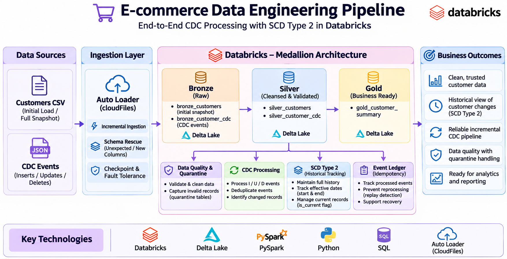

# ecommerce-databricks-data-pipeline
End-to-end E-commerce Data Engineering Pipeline using Databricks, PySpark, Delta Lake, Auto Loader, CDC and SCD Type 2.

# E-commerce Data Engineering Pipeline

## Project Overview

This project demonstrates an end-to-end E-commerce Data Engineering pipeline built using **Databricks, PySpark, Python, SQL, and Delta Lake**.

The pipeline processes messy customer data and incremental CDC events using the Medallion Architecture. It includes data cleansing, validation, quarantine handling, historical data management, and event processing.

## Architecture

**Initial Data Load**

Source CSV → Bronze → Silver → Quarantine → SCD Type 2 History

**Incremental Data Processing**

CDC JSON → Auto Loader → Bronze CDC → Silver CDC → Event Ledger → SCD Type 2 History

## Technologies Used

- Databricks
- PySpark
- Python
- SQL
- Delta Lake
- Unity Catalog
- Databricks Auto Loader

## Key Implementations

- Implemented Bronze, Silver, and Gold layers.
- Performed data cleansing, standardization, validation, and deduplication.
- Created a quarantine table for invalid records.
- Implemented incremental CDC ingestion using Auto Loader.
- Processed INSERT, UPDATE, and DELETE events.
- Implemented SCD Type 2 using Delta MERGE.
- Maintained an event processing ledger.
- Explored replay detection, failure recovery, and out-of-order event scenarios.

## Project Structure

```text
ecommerce-databricks-data-pipeline/
├── README.md
├── notebooks/
├── architecture/ 
```

## Learning Outcomes

This project provided hands-on experience with incremental data ingestion, Delta Lake operations, CDC processing, historical data management, and data pipeline reliability concepts.

## Future Enhancements

- Refresh the Gold layer from current SCD Type 2 records.
- Strengthen event-level recovery and out-of-order processing.
- Add automated data quality checks and monitoring.
